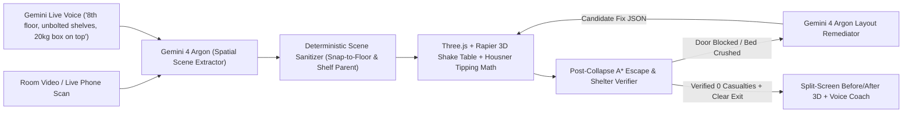
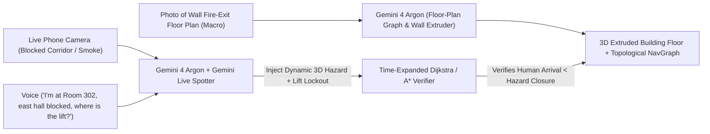

# Google DeepMind Hackathon at Imperial — Finalist Blueprints (Plan B vs. Plan C)

> [!IMPORTANT]
> **Timeline Check:** Demos are at **4:30 PM**. Spend at most **10 minutes** reading this as a team, pick **Plan B** or **Plan C**, copy the matching `AGENTS.md` and `src/types/contracts.ts` into the repo, and start building on your assigned folders.

---

## Quick Team Vote: Plan B vs. Plan C

| Dimension | **Plan B: QuakeRoom** *(Single Room Video $\to$ 3D Earthquake Collapse + Escape/Shelter Verifier)* | **Plan C: ExitZero** *(Floor Plan + Live Camera $\to$ 3D Building Dynamic Evacuation Verifier)* |
| :--- | :--- | :--- |
| **One-Sentence Pitch** | Scan any room $\to$ watch a 6.8M earthquake topple furniture in 3D, see if the exit gets blocked or the bed gets crushed, and let Gemini + a physics verifier rearrange the room so you survive and escape. | Scan any building's wall floor-plan sign + point your live camera at a corridor hazard $\to$ extrude a 3D building twin that blocks death-trap lifts, models hazard spread, and verifies the fastest survivable escape route. |
| **Track 2 Modalities** | **Room Video/Camera** (furniture layout) + **Gemini Live Voice** (floor level, renter constraints, heavy shelf loads) + **3D Physics & A\* Egress** | **Macro Photo** (wall floor plan) + **Live Egocentric Camera** (smoke/debris blockage) + **Gemini Live Voice** (panic spotter & lift override) + **3D Building Twin** |
| **Deterministic Verifier (Rigor)** | 1) Analytical Center-of-Mass Overturning ($SF = \frac{b/h_{\text{CoM}}}{a_{\text{floor}}/g}$)<br>2) Rapier 3D Rigid-Body Collapse<br>3) Post-Collapse 2D Grid **A\* Escape & Safe-Shelter Pathfinder** | 1) Time-Expanded **Dijkstra / A\*** Evacuation Solver ($t_{\text{human}}(e) < t_{\text{hazard\_closure}}(e)$)<br>2) Deterministic Safety Rule Engine (Lift lockout in fire/seismic + accessible refuge routing) |
| **Judge Score Prediction** | **38 / 40** *(Viscerally dramatic 3D physics + counter-intuitive insights like moving heavy items to bottom shelves)* | **35 / 40** *(Great live Imperial venue integration using the actual building floor plan outside the room)* |
| **4-Hour Build Reliability** | **9.0 / 10** *(Self-contained rectangular room + 8 clean 3D furniture prefabs)* | **8.0 / 10** *(Requires clean 2D-wall-polygon to 3D extrusion from a photo)* |
| **15-Minute Validation Test** | Send 1 room photo to Gemini 4 Argon $\to$ verify returned JSON `(x_m, z_m)` places bed, shelf, desk, and door in the right spots on a 2D/3D grid. | Send 1 photo of an Imperial hallway fire-exit map to Gemini 4 Argon $\to$ verify returned JSON nodes & wall segments match the hallway layout. |

---

# PLAN B: **QuakeRoom**
### *Seismic Room Collapse, Safe-Shelter & Escape Route Verifier*

### 1. System Architecture & Modality Interdependence



* **Why Vision, Voice, and 3D Physics Genuinely Need Each Other:**
  * **Vision** sees *where* the bed, bookshelf, window, desk, and exit door are.
  * **Voice (Gemini Live)** knows what Vision *cannot* see: what floor of the building you are on (floor sway amplification), whether you are a renter who cannot drill into walls, and which shelf items are heavy vs. hollow.
  * **3D Physics + A\* Pathfinder** proves deterministically that an unanchored wardrobe next to the door will pitch over during a 6.8M quake and **trap the occupant inside**, or that shattered glass cuts off the barefoot path from the bed to the exit.

---

### 2. Plan B — Exact TypeScript / JSON Contracts (`src/types/contracts.ts`)

```typescript
export type ObjectCategory =
  | "bed"
  | "bookshelf"
  | "wardrobe"
  | "desk"
  | "chair"
  | "tv_monitor"
  | "heavy_item"
  | "fragile_glass"
  | "window"
  | "exit_door";

export interface RoomObjectNode {
  id: string;
  category: ObjectCategory;
  label: string;
  // Floor-standing objects have parent_id = null and (x_m, z_m) relative to room SW corner (0,0)
  // Stacked items have parent_id = "bookshelf_1" | "desk_1" and shelf_level = "bottom" | "middle" | "top"
  parent_id: string | null;
  shelf_level?: "bottom" | "middle" | "top";
  x_m: number;
  z_m: number;
  width_m: number;
  height_m: number;
  depth_m: number;
  rotation_deg: 0 | 90 | 180 | 270;
  mass_kg: number;
  anchored_to_wall: boolean;
  is_fragile: boolean;
  is_occupant_start?: boolean; // e.g., true for bed or desk chair
}

export interface RoomSceneGraph {
  room: {
    width_m: number;
    depth_m: number;
    height_m: number;
    floor_level: number; // From voice input (default 1; higher floors amplify PGA)
    renter_no_drill: boolean; // From voice input: if true, fixes cannot just say "bolt everything"
  };
  earthquake: {
    magnitude_mw: number; // e.g., 6.8
    duration_s: number;   // e.g., 6.0
    dominant_axis: "X" | "Z" | "XZ";
  };
  objects: RoomObjectNode[];
}

export interface ObjectHazardResult {
  object_id: string;
  analytical_safety_factor: number; // SF = (b / h_CoM) / (a_floor / g); < 1.0 means tips
  tipped_over: boolean;
  shattered_or_fell: boolean;
  hit_occupant_zone: boolean;
  blocked_exit_corridor: boolean;
  peak_kinetic_energy_joules: number;
  resting_bbox_2d: { min_x: number; max_x: number; min_z: number; max_z: number };
}

export interface EgressAndShelterResult {
  survivable: boolean;
  exit_reachable_post_quake: boolean;
  // Shortest A* path (0.2m grid cells) from occupant_start to exit_door AFTER furniture collapses
  escape_path_points_m: Array<{ x_m: number; z_m: number }>;
  // Nearest safe Drop-Cover-Hold spot during shaking (under desk / outside fall shadows)
  safe_shelter_spot_m: { x_m: number; z_m: number; label: string } | null;
  shelter_reach_time_s: number;
  blocking_object_ids: string[];
  glass_hazard_zones_m: Array<{ x_m: number; z_m: number; radius_m: number }>;
  object_results: ObjectHazardResult[];
}

export interface RemediationProposal {
  summary_spoken: string; // Short 2-sentence explanation for Gemini Live TTS
  changes: Array<{
    object_id: string;
    action: "move_floor_position" | "relocate_shelf_level" | "swap_objects" | "anchor_strap";
    reason: string;
    new_x_m?: number;
    new_z_m?: number;
    new_rotation_deg?: 0 | 90 | 180 | 270;
    new_parent_id?: string | null;
    new_shelf_level?: "bottom" | "middle" | "top";
  }>;
  updated_scene: RoomSceneGraph;
}
```

---

### 3. Plan B — 5-Person Role Split & Folder Ownership

| Person | Role | Owned Folder (No one else edits!) | Key Deliverables |
| :--- | :--- | :--- | :--- |
| **P1** | **Vision-to-Scene-Graph Engineer** | `src/vision/` & `src/app/api/extract/` | Takes video/frames + voice context $\to$ calls **Gemini 4 Argon** with structured JSON schema $\to$ runs the **Deterministic Scene Sanitizer** (snaps floor items to `y=0`, resolves 2D bbox overlaps, snaps child items to parent shelf heights). |
| **P2** | **3D Shake Table & Furniture Prefabs** | `src/scene3d/` | `@react-three/fiber` + `@react-three/rapier` 3D room renderer. Builds clean procedural 3D prefabs for `bed`, `bookshelf` (with items on shelves!), `desk`, `wardrobe`, `window`, `exit_door`, plus animated 3D escape path & red fall-shadow cones. |
| **P3** | **Deterministic Physics & A\* Egress Verifier** | `src/solver/` | 1) Analytical Housner overturning calculator ($h_{\text{CoM}}$ including top-shelf vs. bottom-shelf items).<br>2) 2D occupancy grid **A\* pathfinder** (`occupant` $\to$ `exit_door` & `occupant` $\to$ `safe_shelter`) before and after collapse.<br>3) Verification loop harness. |
| **P4** | **Gemini Live Voice + Remediation Agent** | `src/voice/` & `src/app/api/remediate/` | WebSocket / WebAudio voice input & expressive voice output ("I'm on the 9th floor, renting, heavy books on top shelf"). Calls Gemini 4 Argon to propose `RemediationProposal` when `EgressAndShelterResult.survivable === false`. |
| **P5** | **Split-Screen UI, Demo State Machine & Presets** | `src/components/` & `src/presets/` | Main dashboard (`Before` vs. `Verified After` toggle, Richter magnitude slider, live telemetry cards, 1-click instant backup room presets filmed at Imperial so the demo cannot fail). |

#### Hour-by-Hour Milestones (`12:30 PM → 4:30 PM`)
* **12:30 – 1:00 PM:** Lock contracts in `src/types/contracts.ts`. P5 creates 2 hardcoded gold-standard `RoomSceneGraph` JSON fixtures so P2, P3, and P4 can work immediately without waiting for P1's camera API.
* **1:00 – 2:15 PM:** Core modules working standalone:
  * P1: Video/photo upload $\to$ valid `RoomSceneGraph` JSON in <10s.
  * P2: 3D room shakes on button click; unanchored tall shelves tip over; escape path renders as glowing green/red tube on floor.
  * P3: Analytical $SF_{\text{tip}}$ + post-collapse A\* grid returns `exit_reachable_post_quake: false` when wardrobe falls across doorway.
  * P4: Voice updates `floor_level` & `renter_no_drill`; Remediation API generates a fixed layout that passes P3's verifier.
* **2:15 – 3:15 PM:** End-to-end integration on `main`. Wire the automatic verification loop: `Scan -> Shake -> Fail (Door Blocked & Bed Hit) -> Gemini Fix -> Re-Shake -> Pass (0 Hits, Clear Exit)`.
* **3:15 – 4:00 PM:** Stage polish, high-contrast hazard shaders, record 60-second fallback video, rehearse the 3-minute live script 4 times.

---

### 4. Plan B — 3-Minute Live Demo Script (Zero Slides)

* **0:00 – 0:15 (The 10-Second Live Hook — Courage):**
  * No title slide. App is open full-screen. Presenter 1 holds up a phone showing a 5-second video sweep of a cramped student bedroom (tall bookshelf next to the bed, wardrobe right by the exit door, monitor on desk) — *or scans a staged corner on the demo table live*.
  * *"Over half of urban earthquake injuries happen inside bedrooms from falling furniture and blocked exits. Watch what happens to this student room in a 6.8 earthquake."*
* **0:15 – 1:05 (Multimodal Input — Vision + Gemini Live Voice — Alchemy):**
  * Gemini 4 Argon turns the video into an interactive 3D room in seconds.
  * Presenter 2 speaks into the mic to **Gemini Live**: *"I live on the 10th floor, I'm a student renter so I can't drill anything into the walls, and the top shelf has 20 kilos of textbooks."*
  * Watch the UI live-update `Floor: 10 (PGA Amplified 2.2x)`, `Renter Mode: No Wall Drilling`, and highlight the top shelf's elevated Center of Mass ($h_{\text{CoM}} = 1.48\text{m}, SF = 0.54$).
* **1:05 – 1:55 (The 6.8M Shake & Deterministic Failure — Rigor):**
  * Hit **"Trigger 6.8M Quake"**. The 3D floor violently oscillates with a real P/S-wave profile.
  * The top-heavy bookshelf pitches onto the bed ($410\text{ J}$ impact); the tall wardrobe tips across the doorway; window glass shatters across the floor.
  * The **Deterministic A\* Egress Verifier** flashes red on the floor grid: **`EXIT BLOCKED BY WARDROBE_1 — OCCUPANT TRAPPED`**.
  * Gemini Live speaks urgently: *"Critical failure. You cannot reach the door or the lift—and never take a lift in a seismic event. Your wardrobe's 2-meter fall shadow seals the exit door, and the top-heavy bookshelf crushes the sleep zone."*
* **1:55 – 2:45 (Self-Correcting Remediation & Verification Loop):**
  * Click **"Synthesize & Verify Renter-Safe Layout"**.
  * Gemini 4 Argon proposes a 3-part zero-drill fix—and **tests it inside the deterministic solver before showing you**:
    1. Moves the 20kg textbooks from the **top shelf to the bottom shelf** (dropping $h_{\text{CoM}}$ from $1.48\text{m} \to 0.58\text{m}$, raising $SF$ to $1.42$—it acts as a natural ballast!).
    2. Swaps the bed and desk out of the window shatter cone.
    3. Slides the wardrobe $1.2\text{m}$ away from the door hinge.
  * Hit **"Re-Run 6.8M Verification"**: Both rooms shake side-by-side. On the left, the old room collapses and traps the exit. On the right, the bottom-weighted bookshelf stays upright, the **1.2-second Drop-Cover-Hold path under the desk** is clear, and the **green A\* evacuation path to the exit door stays 100% open**.
* **2:45 – 3:00 (Closing Punchline):**
  * *"Vision sees the room. Voice gives the invisible physics constraints. Deterministic mechanics and pathfinding verify you actually make it out the door alive."*

---
---

# PLAN C: **ExitZero**
### *2D Floor-Plan + Live Camera Hazard to 3D Building Evacuation Verifier*

### 1. System Architecture & Modality Interdependence



* **Why Every Modality Is Load-Bearing:**
  * **Macro Floor-Plan Photo** gives global topology (corridors, rooms, stairwells, lifts) that no single room camera can see through walls.
  * **Live Phone Camera** detects real-time local hazards (fallen shelving, fire/smoke blockage, crowded choke point) and maps them onto the 3D building twin.
  * **Gemini Live Voice** localizes the user hands-free while moving, intercepts dangerous instincts (*"Where is the lift?"* $\to$ *"Lifts locked out in fire/seismic mode; routing to Stairwell West"*), and guides turn-by-turn evacuation.

---

### 2. Plan C — Exact TypeScript / JSON Contracts (`src/types/contracts.ts`)

```typescript
export type NodeType =
  | "room"
  | "corridor_junction"
  | "stairwell_exit"
  | "lift_elevator"
  | "accessible_refuge";

export interface NavNode {
  id: string;
  label: string;
  type: NodeType;
  x_m: number; // Normalized to building floor meter grid (e.g. 40m x 25m)
  z_m: number;
}

export interface NavEdge {
  id: string;
  from_node_id: string;
  to_node_id: string;
  length_m: number;
  width_m: number;
  is_stairs: boolean;
}

export interface WallSegment {
  x1_m: number;
  z1_m: number;
  x2_m: number;
  z2_m: number;
  height_m: number;
  is_doorway?: boolean;
}

export interface BuildingFloorGraph {
  building_name: string;
  floor_number: number;
  width_m: number;
  depth_m: number;
  walls: WallSegment[];
  nodes: NavNode[];
  edges: NavEdge[];
}

export interface LiveHazardEvent {
  id: string;
  hazard_type: "structural_debris" | "fire_smoke" | "crowd_bottleneck";
  location_node_id: string;
  affected_edge_ids: string[];
  spread_rate_m_per_s: number; // 0 for static debris, e.g. 0.4 m/s for smoke
  severity: "blocked" | "slow_crawl";
  detected_from: "live_camera" | "voice_report";
  description: string;
}

export interface EvacuationVerificationResult {
  user_start_node_id: string;
  emergency_type: "earthquake" | "fire";
  mobility_mode: "walking_running" | "wheelchair_accessible";
  lift_override_triggered: boolean; // True if user asked for lift or naive shortest path used a lift
  lift_override_reason: string;
  naive_shortest_route: {
    node_ids: string[];
    status: "FATAL_BLOCKED" | "UNSAFE_LIFT" | "SURVIVABLE";
    failure_reason?: string;
  };
  verified_safe_route: {
    node_ids: string[];
    target_exit_label: string;
    total_distance_m: number;
    estimated_travel_time_s: number;
    safety_margin_before_closure_s: number; // Time buffer before expanding smoke/debris reaches path
    turn_by_turn_voice: string;
  } | null;
}
```

---

### 3. Plan C — 5-Person Role Split & Folder Ownership

| Person | Role | Owned Folder | Key Deliverables |
| :--- | :--- | :--- | :--- |
| **P1** | **Floor-Plan-to-3D Graph Extractor** | `src/floorplan/` & `src/app/api/floorplan/` | Takes a photo of a 2D floor plan (including the real Imperial floor plan outside the room!) $\to$ Gemini 4 Argon outputs `BuildingFloorGraph` JSON with normalized coordinates and connected `NavEdge`s. |
| **P2** | **3D Building Extruder & Hazard Visualizer** | `src/scene3d/` | Three.js extrudes `WallSegment[]` into sleek 3D walls, renders glowing `NavNode`s (green stairs, red locked lifts), volumetric smoke/falling debris at `LiveHazardEvent` locations, and animated 3D evacuation ribbons. |
| **P3** | **Deterministic Time-Expanded Evacuation Verifier** | `src/solver/` | Implements time-dependent Dijkstra/A\* where smoke spreads at $v_{\text{smoke}}$ and human moves at $v_{\text{human}}$. Enforces hard deterministic safety constraints: forbids `lift_elevator` in fire/seismic mode, compares **Naive Shortest Path (Fails)** vs. **Verified Safe Path (Survives with $+18\text{s}$ margin)**. |
| **P4** | **Live Camera Hazard Detector + Gemini Live Voice** | `src/live/` & `src/app/api/hazard/` | Streams webcam/phone frame + voice ("I'm at Lecture Theatre 1, the corridor is blocked, get me to the lift!"). Extracts `LiveHazardEvent`, triggers the lift safety override, and speaks turn-by-turn guidance. |
| **P5** | **Command Center UI & Imperial Venue Presets** | `src/components/` & `src/presets/` | Split view (Live Camera + 2D Map Upload + 3D Building Twin + Deterministic Verifier Telemetry comparing Naive Route vs. Verified Route). Pre-loads the exact Imperial building floor plan as a 1-click fallback. |

---

### 4. Plan C — 3-Minute Live Demo Script (Zero Slides)

* **0:00 – 0:15 (The 10-Second Live Hook — Courage):**
  * Hold up a phone photo of the **actual green Fire Evacuation Floor Plan sign from the Imperial College hallway right outside the room**.
  * *"Every building has static 2D evacuation signs on the wall. None of them know which corridor just collapsed or filled with smoke. We scanned the floor plan right outside this room—watch Gemini 4 Argon turn it into a live 3D evacuation twin."*
* **0:15 – 1:10 (Live Camera Hazard + The "Lift Trap" Test — Alchemy):**
  * The 3D Imperial floor pops up on screen.
  * Presenter points the live phone camera at a staged blockade on stage (stacked chairs/boxes blocking a path) and speaks to **Gemini Live**: *"I'm outside Lecture Room 1! The main east corridor just collapsed—what's the fastest route to the lift?!"*
  * **Vision** recognizes the physical blockade and drops a red 3D debris barrier onto East Corridor Edge #4.
  * **Deterministic Safety Verifier** immediately flashes a red **LIFT LOCKOUT OVERRIDE** badge and Gemini Live responds with urgent expressive voice: *"Stop—do not head to the central lift! Seismic and fire rules lock out elevator shafts due to rail distortion and power failure."*
* **1:10 – 2:15 (Deterministic Time-Expanded Route Verification — Rigor):**
  * Show the **Verifier Comparison Panel** on screen:
    * **Naive Shortest Route (Stairwell A via North Hall):** `REJECTED` — smoke/debris expansion reaches Junction 3 in `14s`, human arrival is `19s` (`-5s` fatal overlap).
    * **Verified Safe Route (Stairwell B via West Fire Doors):** `VERIFIED` — `42 meters`, `21s` travel time, `+34s` safety buffer.
  * Watch the 3D camera swoop along the glowing green verified corridor path while red hazard zones expand on the blocked corridor.
* **2:15 – 3:00 (Accessibility / Dynamic Reroute Finale):**
  * Switch toggle to **"Wheelchair / Mobility Impaired Mode"** by voice: *"Wait, my teammate is in a wheelchair and can't use stairs."*
  * The deterministic solver immediately recalculates—since lifts are unsafe and stairs are impassable, it routes to the building's designated **Fire-Rated Evacuation Refuge Point (Node R2)** and dispatches exact 3D coordinates for first responders.

---
---

# Shared `AGENTS.md` (Copy to Repo Root Immediately After Picking)

```markdown
# AGENTS.md — Hackathon Shared Repo Rules (Antigravity, Cursor, Claude Code, Codex)

## 1. Tech Stack & Commands
- **Framework:** Next.js 14+ (App Router, TypeScript, Tailwind CSS)
- **3D & Physics:** `three`, `@types/three`, `@react-three/fiber`, `@react-three/drei`, `@react-three/rapier`
- **AI SDK:** `@google/genai` (Gemini 4 Argon for spatial JSON extraction & remediation; Gemini Live / WebAudio for voice)
- **Commands:**
  - `npm install` — install dependencies
  - `npm run dev` — start local dev server on `http://localhost:3000`
  - `npm run typecheck` — run `tsc --noEmit` (MUST pass before every commit to `main`)

## 2. Golden Rule of This Repo: Strict Folder Ownership
All 5 teammates are committing directly to `main` using AI coding agents. To guarantee **ZERO merge conflicts**:
1. **`src/types/contracts.ts` is LOCKED.** Do not modify interfaces in `src/types/contracts.ts` without announcing to all 5 teammates first.
2. **Stay strictly inside your assigned folder:**
   - **Person 1 (Vision/Ingestion):** `src/vision/`, `src/app/api/extract/`
   - **Person 2 (3D & Physics Scene):** `src/scene3d/`
   - **Person 3 (Deterministic Solver & A* Verifier):** `src/solver/`
   - **Person 4 (Voice & Remediation Agent):** `src/voice/`, `src/app/api/remediate/`
   - **Person 5 (Main UI Shell & Presets):** `src/components/`, `src/presets/`, `src/app/page.tsx`
3. **Never run `npm install <package>` without telling Person 5** so `package-lock.json` does not conflict.

## 3. Coding Agent Rules
- Always import shared types from `@/types/contracts`.
- Every module must export a clean function or React component that works with the mock presets in `src/presets/` even if the live API key or Wi-Fi drops on stage.
- Run `npx tsc --noEmit` before `git commit && git push origin main`.
- Keep commits small and frequent (every 15–20 minutes): `git pull --rebase origin main && git push origin main`.
```
